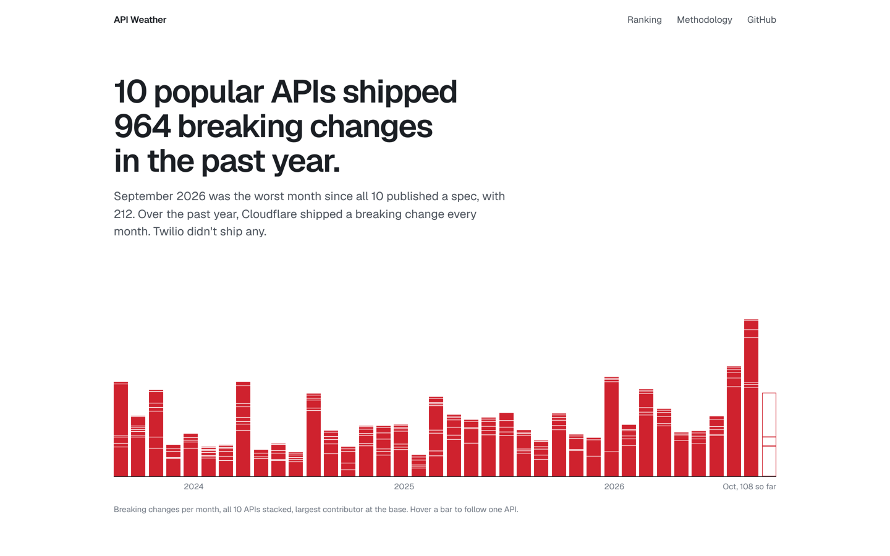

# API Weather

**How often do popular APIs break the code that depends on them?**

API Weather tracks the public OpenAPI specs of 15 well-known APIs, compares every month with the one before, and counts the changes that would break an existing client. It updates itself every day.

**→ [See the live site](https://fladioarmandika.github.io/api-time-machine/)**



## What the data shows

As of October 2026:

- **These 15 APIs shipped more than 1,300 breaking changes in the past year.** September 2026 was the worst month since all of them had a public spec.
- **Cloudflare shipped a breaking change every single month** of the past year. **Twilio didn't ship one.**
- **The roughest month on record** was Stripe in May 2018: 223 breaking changes across 191 endpoints.

The live site has the current numbers, a page for every API with its full history, and a log of each change.

## Use it

- **[Your stack](https://fladioarmandika.github.io/api-time-machine/stack/):** pick the APIs your product depends on to see their combined record and compare them side by side. The link keeps your picks, so you can share it.
- **[Search](https://fladioarmandika.github.io/api-time-machine/search/):** find every breaking change that touched an endpoint or a field, for example `/v1/charges` or `total_tokens`.
- **RSS feeds:** follow [every API](https://fladioarmandika.github.io/api-time-machine/feed.xml) or just one, such as [Stripe](https://fladioarmandika.github.io/api-time-machine/feed/stripe.xml), to hear about each month that broke something.
- **README badges:** each API's page has a badge with its stability score, like , that updates with the data.

## The APIs tracked

| API | Spec it reads |
| --- | --- |
| Stripe | [stripe/openapi](https://github.com/stripe/openapi) |
| GitHub | [github/rest-api-description](https://github.com/github/rest-api-description) |
| OpenAI | [openai/openai-openapi](https://github.com/openai/openai-openapi) |
| Twilio | [twilio/twilio-oai](https://github.com/twilio/twilio-oai) |
| Cloudflare | [cloudflare/api-schemas](https://github.com/cloudflare/api-schemas) |
| Discord | [discord/discord-api-spec](https://github.com/discord/discord-api-spec) |
| PagerDuty | [PagerDuty/api-schema](https://github.com/PagerDuty/api-schema) |
| Plaid | [plaid/plaid-openapi](https://github.com/plaid/plaid-openapi) |
| Asana | [Asana/openapi](https://github.com/Asana/openapi) |
| Box | [box/box-openapi](https://github.com/box/box-openapi) |
| Figma | [figma/rest-api-spec](https://github.com/figma/rest-api-spec) |
| Datadog | [DataDog/datadog-api-client-go](https://github.com/DataDog/datadog-api-client-go) (API v2) |
| Sentry | [getsentry/sentry-api-schema](https://github.com/getsentry/sentry-api-schema) |
| Okta | [okta/okta-management-openapi-spec](https://github.com/okta/okta-management-openapi-spec) |
| Resend | [resend/resend-openapi](https://github.com/resend/resend-openapi) |

The exact file for each one is in [`apis.json`](apis.json).

## What counts as a breaking change

A change that could make working client code fail, for example:

- an endpoint or a response field is removed
- a field changes type, say from a string to an object
- a request parameter that used to be optional becomes required
- a response field that was always present can now be missing or null

Changes that only add things, like a new enum value, are counted separately as **soft** changes. Strict clients can still trip on them, so they count for a little in the score, but they aren't called breaking.

The detection itself is done by [oasdiff](https://github.com/oasdiff/oasdiff), an open-source OpenAPI diff tool. When one schema change shows up on hundreds of endpoints, it's counted once.

## The stability score

Each API gets a score out of 100. It's based on breaking changes per endpoint over the last 12 months, with recent months weighted more, so a big API isn't punished just for being big. 100 means nothing broke all year. The [methodology page](https://fladioarmandika.github.io/api-time-machine/methodology/) has the formula.

## Things to keep in mind

- **The spec isn't the API.** When a vendor corrects a mistake in its spec, that shows up here as a change even if the live API never moved.
- **Versioned APIs.** Stripe, GitHub and Plaid version their APIs. These numbers track the latest version, and clients pinned to an older one may not be affected until they upgrade.
- **Beta endpoints.** Datadog, Cloudflare, Box, Okta, Sentry and GitHub mark preview endpoints in their specs. Breaking changes that only touch those are listed but not counted. The other APIs don't mark them, so everything counts.
- **Monthly snapshots.** Something added and removed within the same month won't show up.

## How it works

1. A daily [GitHub Action](.github/workflows/update-data.yml) clones each vendor's spec repo.
2. It takes the spec as it stood at the end of every month and compares each month with the previous one using oasdiff.
3. The results are written as JSON to [`data/`](data/) and committed back to this repo.
4. A static [Astro](https://astro.build) site in [`site/`](site/) is rebuilt from that data and published to GitHub Pages.

There's no server and no database. Everything is in this repo, and the data format is documented in [`data/README.md`](data/README.md).

## Run it yourself

You need Node 22 or newer and [oasdiff](https://github.com/oasdiff/oasdiff#installation) 1.33 or newer.

```sh
# Rebuild the data (the first run downloads the full history and takes a while)
cd pipeline
npm install
npm run build
ONLY=stripe npm run build   # just one API

# Run the site locally
cd ../site
npm install
npm run dev
```

## Add an API

Any API that publishes an OpenAPI 3 spec in a public GitHub repo can be added. Add an entry to [`apis.json`](apis.json) with the repo, branch and file path, run the pipeline, and open a pull request.

## License

MIT. Built by [Fladio Armandika](https://github.com/FladioArmandika).
